<!-- Perfil do ShiroKazer: 白 (shiro) = branco -->

  

  

  

## ✦ Sobre mim

- 🎵 Construo **bots de Discord** (música com Lavalink, comandos, utilidades)
- 🐍 Escrevo **automações em Python** para resolver coisas chatas do dia a dia
- 🔍 Curto **engenharia reversa**: abrir programas, entender por dentro e documentar
- 🛠️ Faço **suporte técnico**: PC, notebook, redes, formatação e manutenção
- 🎨 Nas horas vagas: **pixel art**, emotes, **Live2D** e muito jogo

## ✦ Ferramentas

  

## ✦ Atividade

  

  

  <picture>
    <source media="(prefers-color-scheme: dark)" srcset="https://raw.githubusercontent.com/shirokazer/shirokazer/output/snake-dark.svg"/>
    <source media="(prefers-color-scheme: light)" srcset="https://raw.githubusercontent.com/shirokazer/shirokazer/output/snake.svg"/>
    
  </picture>

  

